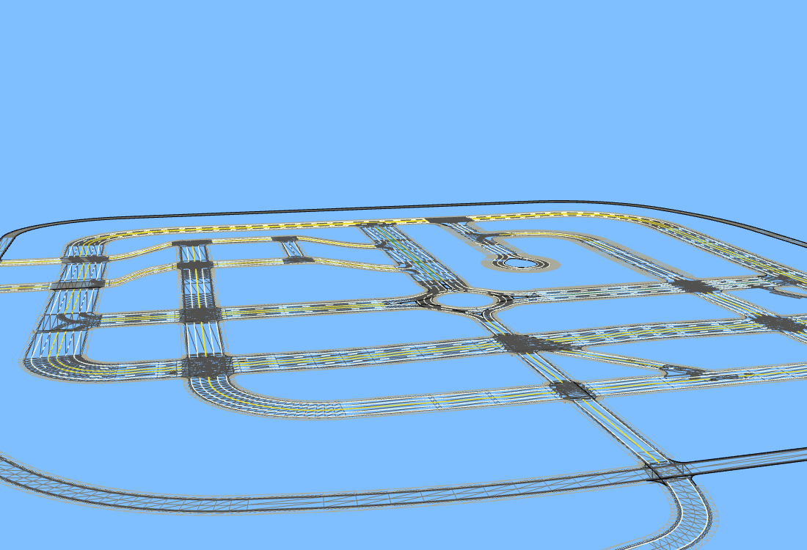
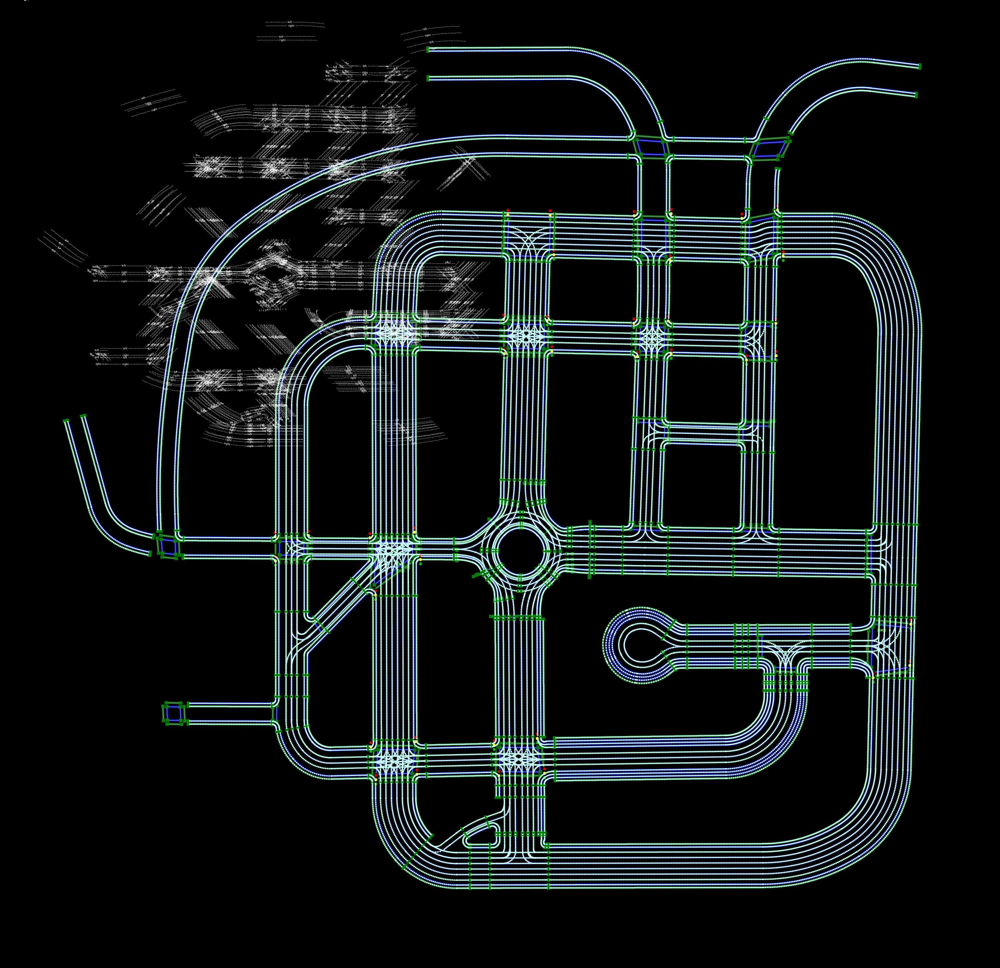
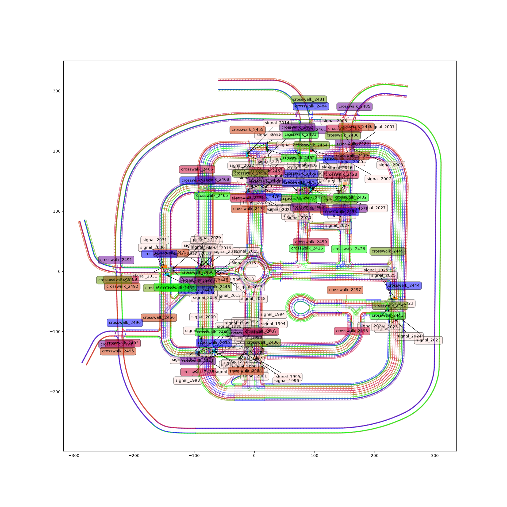
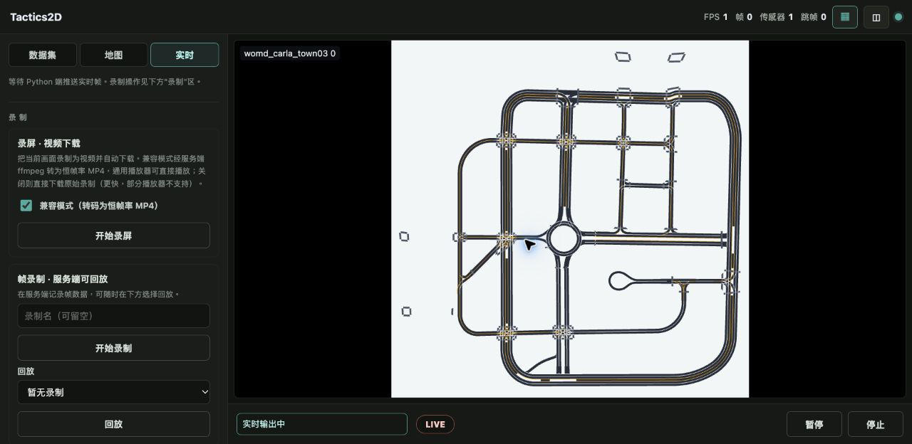

## 前言

說到自動駕駛的地圖，大家可能聽過 OpenDRIVE、Lanelet2，或是 Apollo 的 HD Map。這些格式都可以記錄道路和車道，但如果把檔案打開來看，會發現裡面的資料長得差滿多的。有的用數學函數描述道路，有的把車道拆成左右兩條邊界，也有的直接把中心線和相鄰車道的 ID 全部列出來。

那為什麼需要這麼多種格式呢？模擬器要產生道路，車上的規劃系統要判斷車子能往哪裡走，而行為預測模型需要知道道路配置，以及車輛、行人等交通參與者如何移動，所以各自需要的資訊也不同。本文用 CARLA 的 Town03 地圖，介紹 OpenDRIVE、Autoware 使用的 Lanelet2、Apollo HD Map，以及 Waymo Open Motion Dataset 的地圖結構，接著比較它們互相轉換時會遇到什麼問題。

## 自動駕駛地圖的內容

我們平常用導航，大多只需要知道從 A 到 B 要走哪條路。但自動駕駛還需要知道自己在哪一條車道、車道有多寬、前面接哪條車道、能不能往左右變換車道，以及紅綠燈控制哪些車道等等，因此地圖需要記錄的資訊會細很多。

這些資訊大致可以分成幾何（geometry）、拓樸（topology）和語意（semantics）。幾何基本上就是道路的形狀與位置，像是平面座標和高度；拓樸則是車道之間如何連接，例如前後接續和左右相鄰；語意代表的是車道類型、標線、速限與交通規則。舉例來說，兩條車道並排相鄰，描述的是它們在幾何上的位置關係；至於能不能變換車道，就還要看中間的標線是虛線還是實線，以及相關的交通規則。

另外，自動駕駛也會使用點雲地圖做定位，模擬器則可能另外有建築物、樹木和路面材質。本文主要介紹道路與車道的資料格式，這些檔案並沒有包含整個模擬場景所需的模型與素材。

### CARLA Town03

為了比較格式差異，這邊使用同一份 Town03，把原始 OpenDRIVE 轉成另外三種格式。來源是 Scenic 專案收錄的 CARLA `Town03.xodr`，由 RoadRunner 產生，版本為 OpenDRIVE 1.4。Town03 有圓環、多車道路口，也有高低起伏的道路，適合拿來比較各種格式如何描述道路。


（圖一：esmini odrviewer 直接讀取 Town03 OpenDRIVE 的畫面）

圖一可以看到道路的高低變化，以及中央的圓環。這裡只載入道路地圖，沒有 CARLA 完整的城市模型，有些物件因為缺少外部模型，只會顯示簡化後的形狀。

這份資料有 417 段 `driving` 車道，總長約 13.718 km，另外還有 12 段 `bidirectional` 車道、35 個路口、38 個紅綠燈物件與 73 處行人穿越道。紅綠燈共控制 112 段車道，取樣後的高度範圍約為 −0.87 到 8.51 m。這裡統計的是檔案中分段記錄的車道，同一條車道可能被切成好幾段，所以不能說整座城市有 417 條車道。

四種格式的主要差異如下：

| 格式 | 主要用途 | 幾何表示 | 車道連接關係 | 檔案形式 |
| --- | --- | --- | --- | --- |
| OpenDRIVE | 道路設計與模擬器之間的資料交換 | 參考線與寬度、海拔高度函數 | road、lane 與 junction 的 link | XML，`.xodr` |
| Lanelet2 | 路徑規劃與通行規則判斷 | 左右邊界折線，也可有中心線 | 由共用邊界、端點與規則建立路由圖 | OSM XML，`.osm` |
| Apollo HD Map | Apollo 的路徑規劃、行車規劃與行為預測 | 車道參考軌跡與左右邊界 | 明確列出前後接續與左右相鄰車道 | Protobuf，`base_map.bin` |
| Waymo Open Motion | 行為預測與場景研究 | 中心線、標線與路緣點列 | 車道 ID 與點列索引範圍 | Scenario Protobuf，通常包在 TFRecord |

## OpenDRIVE

[OpenDRIVE](https://www.asam.net/fileadmin/Standards/OpenDRIVE/ASAM_OpenDRIVE_BS_V1-7-0.html) 是 ASAM 制定的道路資料標準，CARLA、esmini 等模擬工具都可以使用。它最基本的概念是道路參考線（reference line），每條 road 先定義一條參考線，再以這條線為基準，記錄各條車道與道路物件的位置。

我們可以把參考線想成道路的基準。沿著線前進的距離叫 `s`，往左右偏移的距離叫 `t`，所以 `(s, t)` 就能表示道路上的位置。參考線不一定是某條車道的中心線，但我們可以以它為基準，用同一套座標來描述整條道路的形狀與位置。詳細定義可以看 [ASAM 的參考線座標說明](https://publications.pages.asam.net/standards/ASAM_OpenDRIVE/ASAM_OpenDRIVE_Specification/v1.8.1/specification/08_coordinate_systems/08_03_reference_line_coordinate_system.html)。

參考線的平面形狀放在 `planView` 裡，可以把直線（line）、圓弧（arc）、緩和曲線（spiral）等接起來，組成一條參考線。車道則放在 `laneSection` 裡，用寬度函數描述。讀取工具沿著參考線計算座標，再往左右加上車道寬度，就可以得到車道邊界。因此 OpenDRIVE 不需要把每條車道的每個座標點都存起來。

我們用 Town03 的 Road 8、第一個 lane section、*lane -1* 當範例。這是一段約 18.13 m 長、3.5 m 寬的直線車道，其寬度與外側標線的設定如下，其他屬性與子元素先省略：

```xml
<lane id="-1" type="driving" level="false">
  <width sOffset="0" a="3.5" b="0" c="0" d="0" />
  <roadMark sOffset="0" type="broken" color="white"
            width="0.125" laneChange="both" />
</lane>
```

`width` 的四個係數對應三次多項式 `w(ds) = a + b·ds + c·ds² + d·ds³`，其中 `ds` 是從這段 width 設定的起點算起的距離。這個例子只有 `a` 是 3.5，其他都是 0，因此整段車道的寬度固定為 3.5 m。如果道路逐漸變寬，就可以設定其他係數來描述變化。OpenDRIVE 也有使用 `border` 描述邊界的方式，Town03 這裡採用的是 `width`。

`roadMark` 表示這條右側車道的外側標線，`broken` 和 `white` 就是白色虛線，線寬為 0.125 m。這條車道內側靠近道路中央，對應的標線則要去看中央車道的設定。

OpenDRIVE 的車道 ID 從中央的 0 開始，參考線左邊是 +1、+2，右邊是 −1、−2。以車道 ID −1 來說，不同道路或不同 lane section 裡面都可能有 −1，所以只知道 lane ID，還無法確定是哪條車道，也要知道它屬於哪條 road、哪個 section。正負號表示左右位置，行進方向還要搭配右側或左側通行、雙向車道等設定判斷。

要知道車道前後接到哪裡，則需要讀取 road link、lane link，以及路口 junction 裡的 connection 和 laneLink。舉例來說，一條道路進入路口後可以直行或右轉，junction 會記錄對應的連接道路與車道，讀取程式再把這些資訊整理成可行駛的路網。

OpenDRIVE 也能描述海拔高度（elevation）與橫坡（superelevation，又稱 bank angle）。海拔高度記錄道路沿途的高度，因此可以表示上坡、下坡；橫坡是道路橫向的傾斜，像是彎道內外側的高度差。Town03 的海拔高度有變化，但來源檔裡的 superelevation 係數全為 0。

## Lanelet2

[Lanelet2](https://github.com/fzi-forschungszentrum-informatik/Lanelet2/blob/master/lanelet2_core/doc/LaneletPrimitives.md) 是 Autoware 常用的地圖格式，其基本單位是 lanelet，可以想成左、右兩條折線（linestring）圍起來的一段可通行區域。同一段 lanelet 內，交通規則與能否變換車道的條件都要相同。如果到了某個位置，規則或條件變了，就要從那裡切成另一段 lanelet。

Lanelet2 可以用 OSM XML 儲存，其中 `node` 是座標點，`way` 是一串 node 組成的折線，`relation` 則用來組合左右邊界和規則。注意這裡是沿用 OpenStreetMap 的檔案結構，資料內容仍然是我們自己的車道地圖。

同樣是前面 Road 8 的 *lane −1*，轉成 Lanelet2 後會得到以下 relation：

```xml
<relation id="47981" visible="true" version="1">
  <member type="way" ref="5356" role="left" />
  <member type="way" ref="5377" role="right" />
  <tag k="type" v="lanelet" />
  <tag k="subtype" v="road" />
  <tag k="one_way" v="yes" />
  <tag k="participant:vehicle" v="yes" />
  <tag k="speed_limit" v="80" />
</relation>
```

可以看到 relation 47981 引用左邊的 way 5356 和右邊的 way 5377，再往 way 裡面找 node，才會得到實際座標。這份輸出的 node 有 `lat`、`lon`，並附上 `ele`、`local_x`、`local_y` 標籤，`ele` 記錄高度，`local_x` 和 `local_y` 則記錄區域座標。載入時要使用相符的投影設定，也要確認讀取工具是否會採用這些區域座標。

這裡有一個轉換時很容易忽略的地方，就是相鄰車道應該共用同一個邊界物件。如果兩條車道中間是同一條白色虛線，兩個 lanelet 就應該引用同一條 way。假設我們各產生一條座標完全一樣的 way，畫出來不會有差別，但 Lanelet2 就可能判斷不出它們的相鄰關係。前後接續的 lanelet 也需要正確共用端點。

不過，共用邊界不代表就能變換車道，還要看標線類型和交通規則。例如兩條車道雖然相鄰，中間卻隔著實線，就不能直接跨越實線變換車道。Lanelet2 的 [routing graph](https://docs.ros.org/en/humble/p/lanelet2_routing/) 就會區分哪些相鄰車道可以切換過去，哪些不行。我們也可以依汽車、自行車與行人的通行規則，分別建立路由圖。

紅綠燈、停止線與路權則透過 regulatory element（交通規則物件）描述。比方說一盞紅綠燈控制三條車道，我們可以建立一個 relation 引用燈體和停止線，再讓三個 lanelet 都引用這個規則。這樣規則可以共用，也比較方便擴充。


（圖二：JOSM 套用 Lanelet2 mapcss 樣式的 Town03）

圖二是用 JOSM 畫出的結果，左右邊界、路口與圓環都能看到。JOSM 可以用來檢查與編輯 OSM 裡的物件，至於能不能規劃出從一條車道到另一條車道的路徑，則需要另外用 Lanelet2 的 routing graph 或目標系統測試。

## Apollo HD Map

Apollo HD Map 使用 Protocol Buffers（Protobuf）儲存地圖，一般會看到 `base_map.bin` 二進位檔，也可以輸出文字版 `base_map.txt` 方便檢查。它把車道的幾何與連接資訊放在 [Lane message](https://github.com/ApolloAuto/apollo/blob/master/modules/common_msgs/map_msgs/map_lane.proto) 裡，包括 `central_curve`、左右邊界、長度、速限，以及前後銜接的車道和左右相鄰車道。依照資料結構（schema）的定義，`central_curve` 是參考軌跡，不一定剛好在車道的幾何中心。

我們前面的車道在這份輸出裡叫 `lane_8_0_-1`，把座標點省略後，可以看到以下關係：

```protobuf
id { id: "lane_8_0_-1" }
speed_limit: 22.352
predecessor_id { id: "lane_482_0_-1" }
successor_id { id: "lane_1197_0_-3" }
right_neighbor_forward_lane_id { id: "lane_8_0_-2" }
left_neighbor_reverse_lane_id { id: "lane_8_0_1" }
type: CITY_DRIVING
turn: NO_TURN
direction: FORWARD
```

`predecessor_id` 和 `successor_id` 分別記錄前後銜接的車道 ID，右邊相鄰的是同向車道 `lane_8_0_-2`，左邊相鄰的則是對向車道 `lane_8_0_1`。可以發現前後車道和左右相鄰車道的 ID 都已經列好了，因此要找這條車道接到哪裡時，直接根據 ID 查詢就好，不需要再從邊界判斷車道之間的關係。不過在產生地圖時，就必須確保 ID 記錄的連接關係與車道的實際位置相符，修改道路時也要一起更新。

Apollo 另外使用 [overlap](https://github.com/ApolloAuto/apollo/blob/master/modules/common_msgs/map_msgs/map_overlap.proto) 記錄車道與其他物件的關係，例如 lane 與紅綠燈、行人穿越道、junction 的關聯。overlap 會記錄物件 ID，以及對應 lane 上的 `s` 範圍，因此規劃系統就能知道這個物件影響車道的哪一段。


（圖三：Apollo 官方 mapshow.py 的 Town03 輸出）

圖三中可以看到車道、號誌與行人穿越道。這份轉換保留 road、section、junction 的結構，總共輸出 1,400 個 Lane 和 1,210 個 overlap。Lane 包含 driving、sidewalk、shoulder、parking 等類型，所以數量比前面的 417 段 driving 車道多。

使用 Apollo 地圖時需要注意 Protobuf schema 的版本與座標設定。這份輸出的 header 使用 `tmerc` 投影字串，座標單位是公尺，與其他地圖一起使用時仍然要確認原點和投影是否相同。

## Waymo Open Motion

這邊介紹的是 Waymo Open Motion Dataset（WOMD）的地圖資料，用於行為預測與場景研究。它使用 [Scenario](https://github.com/waymo-research/waymo-open-dataset/blob/master/src/waymo_open_dataset/protos/scenario.proto) 記錄地圖、交通參與者軌跡，以及不同時間點的號誌狀態。本文只轉換道路資料，沒有產生車輛軌跡，因此輸出的 Scenario 只有地圖資料，燈號狀態也都設為未知。

Waymo 的地圖放在 `map_features` 裡，裡面的每個 feature 都有自己的 ID，像是車道中心線 `LaneCenter`、標線 `RoadLine`、路緣 `RoadEdge` 和行人穿越道 `Crosswalk`，都是各自獨立的物件。我們可以在 [map.proto](https://github.com/waymo-research/waymo-open-dataset/blob/master/src/waymo_open_dataset/protos/map.proto) 裡看到完整的定義。它沒有 OpenDRIVE 那種 road 和 lane section 階層，車道主要用中心線點列來描述。

車道左右邊界則由 `BoundarySegment` 記錄，並引用代表標線或路緣的 feature。前面 Road 8 的 lane −1，在這份輸出中對應 feature 103，左邊界的資料如下：

```protobuf
left_boundaries {
  lane_start_index: 0
  lane_end_index: 19
  boundary_feature_id: 100051
  boundary_type: TYPE_SOLID_SINGLE_YELLOW
}
```

這段的意思是，車道中心線第 0 到第 19 個點，其左側邊界對應 feature 100051。要取得邊界座標，就去讀這個 feature 的點列。描述左右相鄰車道的關係時，也會分別記錄這條車道與相鄰車道的點列索引範圍，所以兩條車道只有部分路段相鄰時，也可以分段描述。

這次轉換沿著道路約每隔 1 m 取樣一次，範例裡的實際間距約為 0.954 m。一般來說，取樣越密就能保留越多道路形狀的細節，不過需要儲存的點數也會變多，檔案自然就會變大。


（圖四：Tactics2D 讀取 Town03 Scenario TFRecord 的畫面）

圖四只顯示道路，沒有車輛，因為這份 Scenario 沒有軌跡資料。這次輸出共包含 429 條車道中心線、665 條標線、32 段路緣和 73 處行人穿越道，這 429 條中心線分別來自 417 段 driving 車道和 12 段 bidirectional 車道。Tactics2D 畫的是 XY 平面，若要觀察高度，可以看官方 `plot_maps` 產生的 Plotly 圖。

Waymo 有記錄車道前後如何連接，以及同向的相鄰車道，但道路階層與交通規則不像前面幾種格式那麼完整，而且有些車道沒有左右邊界。如果要把它拿來產生完整的道路模型，就需要補齊這些資訊。這裡討論的是 WOMD 公開資料的結構，並不代表 Waymo 車上使用的完整地圖。

## 紅綠燈的表示方式

除了車道，紅綠燈也是自動駕駛地圖需要記錄的重要資訊。OpenDRIVE 記錄 signal 在道路上的位置，再用 signalReference 與 validity 指定哪些車道受號誌控制；Lanelet2 讓 lanelet 引用紅綠燈的 regulatory element；Apollo 則透過 Signal 和 overlap 記錄號誌與車道的對應關係。

Waymo 比較特別，它會記錄每個時間點，各條車道對應的燈號狀態。Scenario 的 `dynamic_map_states` 裡有 `TrafficSignalLaneState`，記錄號誌控制的 lane ID、燈號狀態和停止點 `stop_point`。也就是說，這邊記錄的是某個時間點、某條車道的燈號狀態，至於燈體的位置與形狀則沒有另外存起來。

| 格式 | 號誌資料 | 如何對應到受號誌控制的車道 |
| --- | --- | --- |
| OpenDRIVE | signal 的位置與屬性 | signalReference、validity |
| Lanelet2 | 燈體與停止線的 regulatory element | lanelet 引用規則 relation |
| Apollo | Signal 的燈體、子燈與停止線 | Signal 與 Lane 的 overlap |
| Waymo Scenario | 各時間點的燈號與停止點 | TrafficSignalLaneState 的 lane ID |

Town03 的 OpenDRIVE 沒有記錄紅、黃、綠燈隨時間切換的資料，所以這次 Waymo 輸出只在時間 0 記錄受號誌控制的車道和停止點，所有燈號都是 `LANE_STATE_UNKNOWN`。如果後續要模擬車子遇到紅燈停下來，就還需要提供號誌時相或其他控制資料。

## 地圖格式轉換

看完這幾種資料結構，可以發現轉換格式時有不少資訊需要重新整理。OpenDRIVE 的寬度函數不能直接放進 Lanelet2 的 way 裡，必須先算出邊界座標；Apollo 要求明確的前後車道 ID，就要把 OpenDRIVE 的道路和路口連接整理好；Waymo 的邊界透過 feature ID 引用，還要算出對應的中心線索引範圍。

這次轉換的三種格式都使用同一份 OpenDRIVE 解析結果。我們先沿參考線取樣，再套用 lane offset、寬度、海拔高度與橫坡，取得中心線和左右邊界。接著整理車道連接、號誌控制與行人穿越道，再分別寫成三種格式。

### 單位與標線

我們先看速限。Road 8 在原始檔案中記錄的速限是 50 mph，三種輸出分別是：

| 格式 | 輸出的速限 | 單位 |
| --- | --- | --- |
| Lanelet2 | `speed_limit="80"` | km/h，這次輸出只保留整數 |
| Apollo | `speed_limit: 22.352` | m/s |
| Waymo | `speed_limit_mph: 50.0` | mph，欄位型別是 double |

同一個速限，在不同格式裡可能使用不同單位，因此轉換時不能直接照抄數字。不保留小數也會造成一些誤差，像是 50 mph 約為 80.4672 km/h，這份 Lanelet2 輸出就沒有保留小數部分。

標線也有類似的問題。Road 8 的 OpenDRIVE 中央標線是 `solid solid` 黃線，但範例轉出後，Lanelet2 只留下 solid 標籤，Apollo 是 `SOLID_YELLOW`，Waymo 則是 `TYPE_SOLID_SINGLE_YELLOW`。也就是說，這條邊界原本是雙黃線，轉換後卻少了這項資訊。Apollo 和 Waymo 其實都有雙黃線型別，所以這個問題要回頭檢查轉換時取用了哪條邊界，以及標線的對應方式。

### 轉換後的資料量

這次各格式保留的車道類型也不同。Lanelet2 輸出了 driving、sidewalk 和行人穿越道，沒有輸出 parking、shoulder；Apollo 保留的類型較多；Waymo 的車道中心線則只輸出 driving 和 bidirectional。這些差異取決於這次轉換程式保留了哪些資料。例如 Lanelet2 還有 Area，也能擴充規則，因此還可以記錄更多內容。

各檔案的大小如下，這裡用 1 MB = 1,000,000 bytes 計算：

| 檔案 | 大小 | 內容 |
| --- | --- | --- |
| OpenDRIVE XML | 4.59 MB | 原始道路參數與物件 |
| Lanelet2 OSM XML | 10.80 MB | 46,765 個 node、1,564 個 way、848 個 relation |
| Apollo 二進位 | 11.27 MB | 1,400 個 Lane、1,210 個 overlap |
| Apollo 文字版 | 43.31 MB | 同一份 Apollo 地圖以文字格式儲存 |
| Waymo TFRecord | 1.27 MB | 1,199 個 map feature，不含軌跡 |

可以看到 Lanelet2 與 Apollo 的檔案都比原始 OpenDRIVE 大，其主要原因是把道路形狀轉成一串座標點後，要儲存的座標變多了；另外同樣是 Apollo 地圖，文字版也比二進位版大很多。Waymo 的檔案最小，但也少了道路階層和部分車道類型，因此這張表只能比較這次輸出的大小，還無法據此判斷哪種格式的儲存效率最好。

### 反向轉換

那轉出來的地圖能不能再轉回 OpenDRIVE 呢？可以重新產生一份，但要還原原本的道路參數就很困難了。以圓弧來說，取樣之後我們只剩下一串座標點，再去擬合時就不一定能得到原本的圓弧參數，此外 road 和 lane section 的切分方式也可能需要重新決定。

Lanelet2 和 Apollo 都有邊界折線，所以幾何比較容易對應，不過仍然要處理各自的結構。Apollo 轉 Lanelet2 時，要把相鄰車道重複儲存的邊界合併成同一條 way；Lanelet2 轉 Apollo 時，則要建立 road、section 和 overlap。至於通行對象的限制、自訂的交通規則，以及各格式特有的物件，也可能找不到可以直接對應的欄位。

從 Waymo 轉回其他格式會更麻煩，因為有些車道沒有邊界，也沒有道路階層與燈體位置。如果從中心線往兩側產生邊界，並把車道寬度設成固定值，這個寬度就是額外假設的，產生的道路不一定跟原本相同。需要這樣處理時，最好把合成的資料標記起來，方便後面檢查。

因此實務上最好保留原始地圖，再以這份地圖為基礎轉成其他格式。來源是 OpenDRIVE 就留著描述道路的函數，來源是 Lanelet2 就留著共用物件和規則，之後要改地圖時也從原始資料修改，避免來回轉換幾次後，很多資訊都找不回來。

## 地圖檢視與驗證

轉完地圖之後，可以先用檢視器（viewer）看一下結果。這邊整理原網站 2026-10-10 的檢視紀錄，桌面版與輕量的檢視工具主要在 macOS arm64 上執行，Apollo 8 Dreamview 則跑在 Linux 後端，再從 Mac 的瀏覽器連線：

| 格式 | 工具 | Town03 的結果 |
| --- | --- | --- |
| OpenDRIVE | esmini odrviewer | 顯示 3D 道路 |
| Lanelet2 | JOSM + Lanelet2 樣式、Tactics2D | 成功顯示道路 |
| Apollo | mapshow.py、Apollo 8 Dreamview | 顯示車道、號誌與行人穿越道 |
| Waymo | 官方 plot_maps、Tactics2D | 成功顯示地圖；Tactics2D 只顯示 XY |

檔案本身也有做檢查：Lanelet2 檢查 XML 物件及其引用關係；Apollo 檢查二進位檔能否解析，以及轉成文字再轉回來後，資料是否一致；Waymo 則檢查 TFRecord CRC、反序列化和索引範圍。這樣可以檢查出 ID 重複、引用的物件不存在或索引超出範圍等問題，但如果是標線對應錯誤，或是把不能變換車道的地方當成可以變換車道，就還需要另外的測試才能發現。

如果要把地圖交給規劃系統，還要測試指定車種是否能沿著規劃的路徑通行、有沒有錯誤地允許車輛跨越實線變換車道，以及紅綠燈是否對應到正確的車道。尤其高架道路在平面圖上也可能交叉，海拔高度和投影就要一起檢查，否則畫面看起來很正常，規劃出的路徑卻可能錯接到不同高度的道路。

## 結論

本文用同一份 Town03 介紹四種自動駕駛地圖格式。OpenDRIVE 主要用參考線與函數描述道路，Lanelet2 用左右邊界組成 lanelet 並搭配交通規則，Apollo 把車道幾何與連接關係明確存起來，Waymo Open Motion 則用 map feature 和時間序列描述場景。

如果想更熟悉這些格式，可以從本文的 Road 8 範例開始，對照它在四種檔案裡的邊界、速限和相鄰車道。真的要做格式轉換時，則要注意單位、共用物件和來源缺少的資訊，轉完也記得用實際要使用地圖的系統，檢查道路形狀與路徑規劃的結果。
