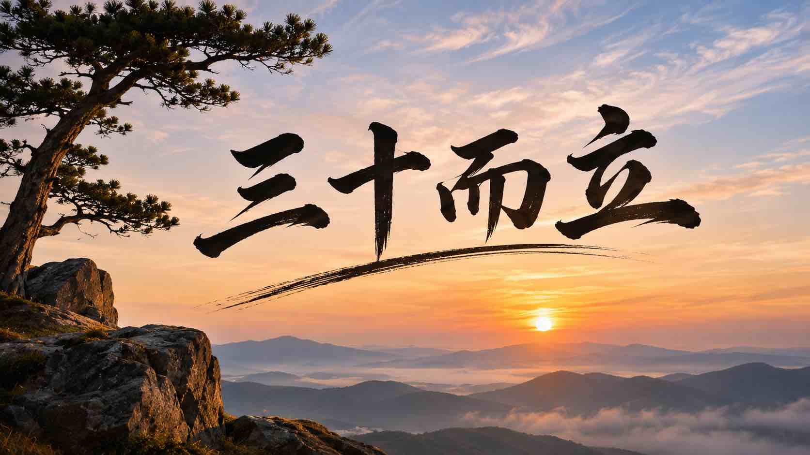

---
title: "Standing Firm at Thirty"
date: 2026-11-15 11:01:00
tags: [thoughts,]
lang: en
translation_key: thirty-years-old
--- 

Confucius said: "At fifteen, I set my heart on learning; at thirty, I stood firm; at forty, I had no more doubts; at fifty, I knew the mandate of Heaven; at sixty, my ear was attuned; at seventy, I could follow what my heart desired without overstepping the bounds."

In the blink of an eye, I have turned thirty as well. It is a very peculiar feeling: on one hand, I feel that I am still not mature enough in all sorts of ways, yet on the other hand, at this age society already regards me as a "mature" adult. There are many things I still feel unprepared for, such as buying a house or having children. My parents' generation usually had children in their twenties, whereas I am now thirty and still do not dare to imagine raising a child; I keep feeling that I am still a child myself.

I do not know how many years I will live, but it is basically certain that 1/3 or even 1/2 of my life has already passed. It is a peculiar feeling: on one hand, thirty years is a very long time, yet on the other hand, it went by in the blink of an eye.

Looking back on the past thirty years: before the age of seven, I was innocent and carefree, and I still have scattered memories of that time that I feel a little nostalgic about when I occasionally think back. Before eighteen, it was compulsory education; I only have memories of studying at school, and it was a very boring period. Before twenty-five, university and graduate school were the period in which I had my real intellectual awakening, took my first steps into society, and developed my worldview. Before thirty, I was truly tempered by society in the workplace and came to fully understand my own aspirations and capabilities.

After thirty, there are just three things I want to focus on: health, knowledge, and career. As for health, mine truly cannot withstand the passage of time. All kinds of ailments, big and small, have appeared within the past year or two, and I can expect my body to get worse and worse as I get older, so after thirty I will certainly pay more attention to taking care of my health. As for knowledge, even though I have a master's degree, my understanding of all things is still too shallow; I have not yet mastered the various fields of knowledge thoroughly, nor integrated them into a body of learning of my own. I think I am currently sitting in the "Valley of Despair" of the Dunning–Kruger effect. Finally, there is career. To me, the meaning of life is to accomplish something great in my career that contributes to humanity. I do not yet know what my life goal is, nor how to achieve it, but this will be the direction I work toward over the coming decades.

On the subject of experiencing life, I recommend a game called "[1 in 8 Billion](https://1in8b.life/zh/)". You can simulate the entire life, from birth to death, of people from different countries, different ethnic groups, and different social classes around the world. This game is something I cannot put down. You can experience being born in Africa only to die right after birth, or being born into a low-caste family in India with no way of ever turning your fate around, or perhaps being born in a Western country and living a comparatively affluent life. After experiencing all kinds of lives, I feel that I am lucky. Perhaps we are not the favored children of heaven, but being born in a country that is democratic, economically prosperous, and rich in educational resources, and growing up safe and sound, is already a very fortunate thing.

I am grateful to my parents for raising and educating me. I think I have truly achieved "standing firm at thirty": I have now settled down and established my career in Japan, married a beautiful and virtuous wife, and work a job I love. I do not have to worry about food or clothing, I travel around throughout the four seasons of the year, and at this moment, at thirty, everything in my life is happy and fulfilling.
