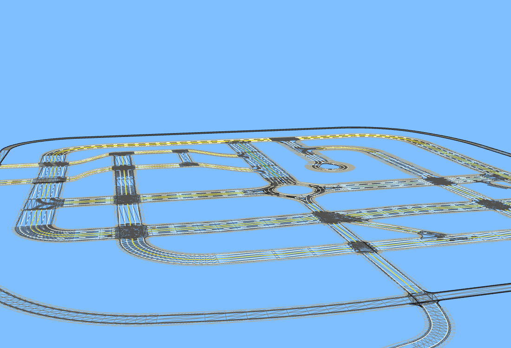
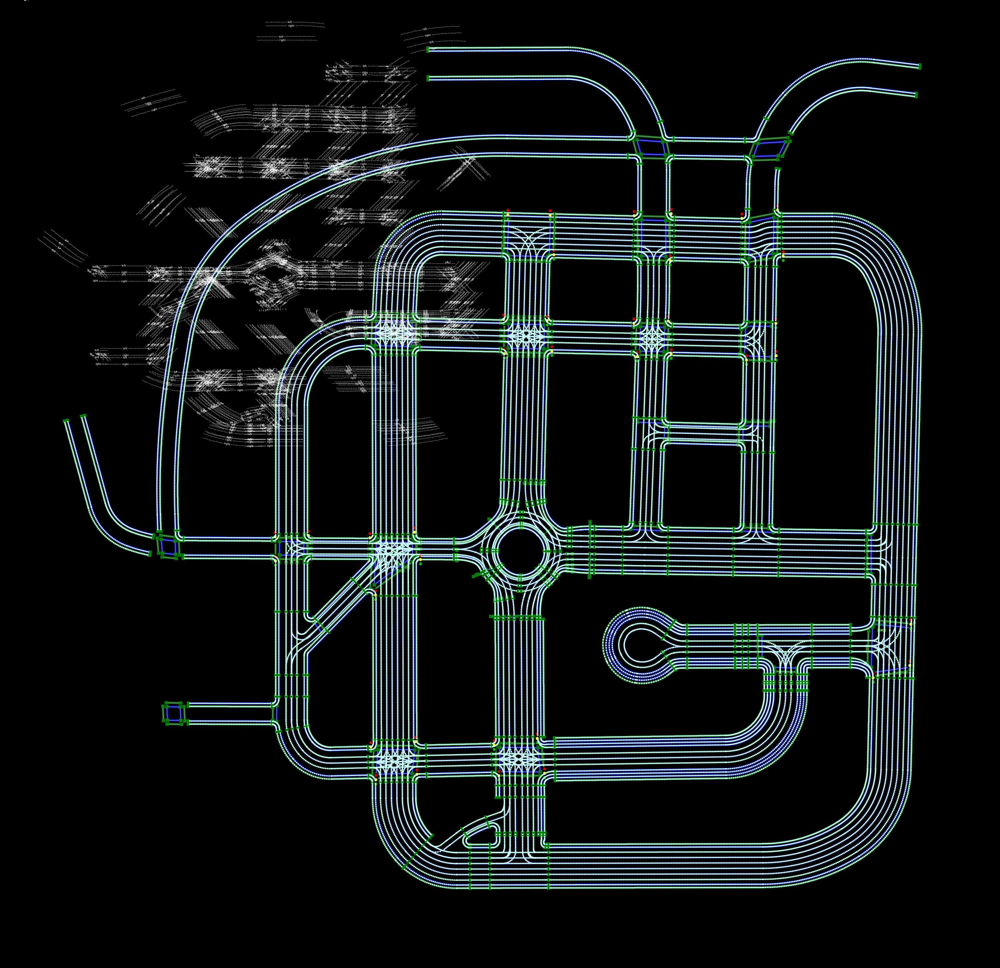
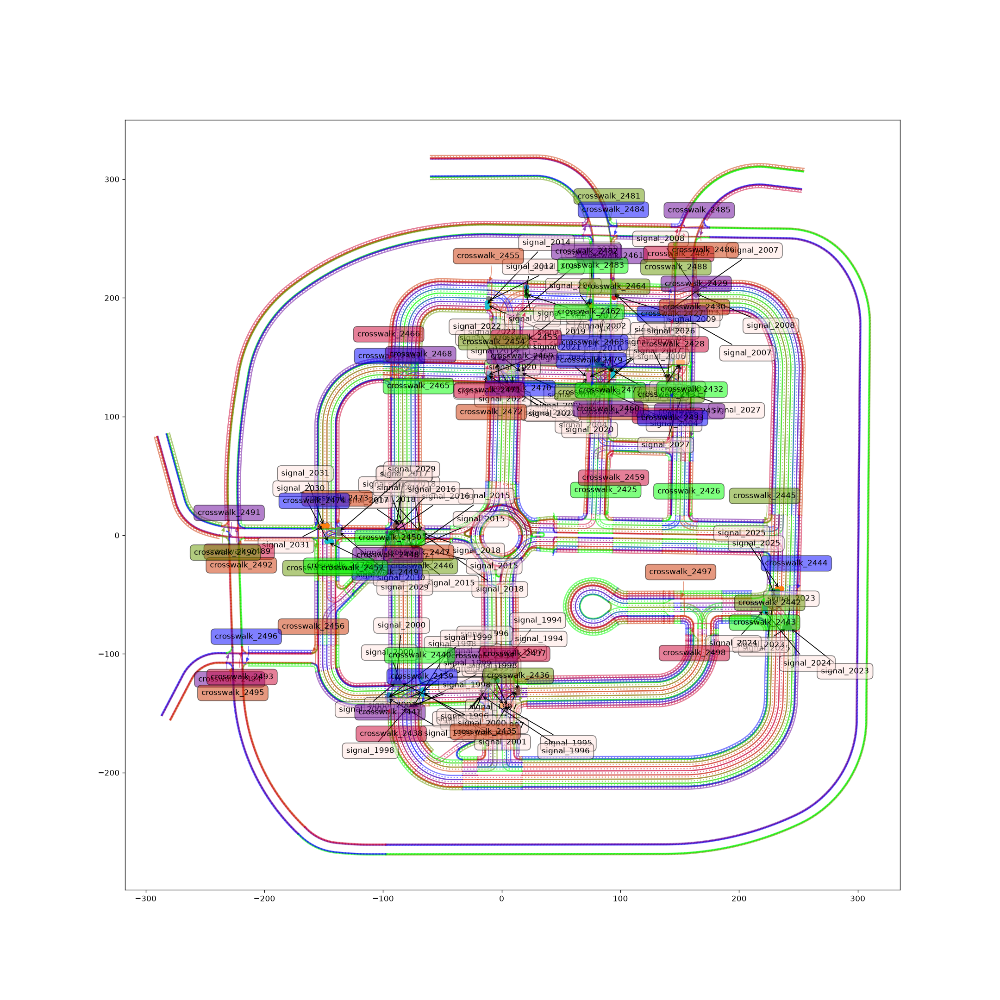
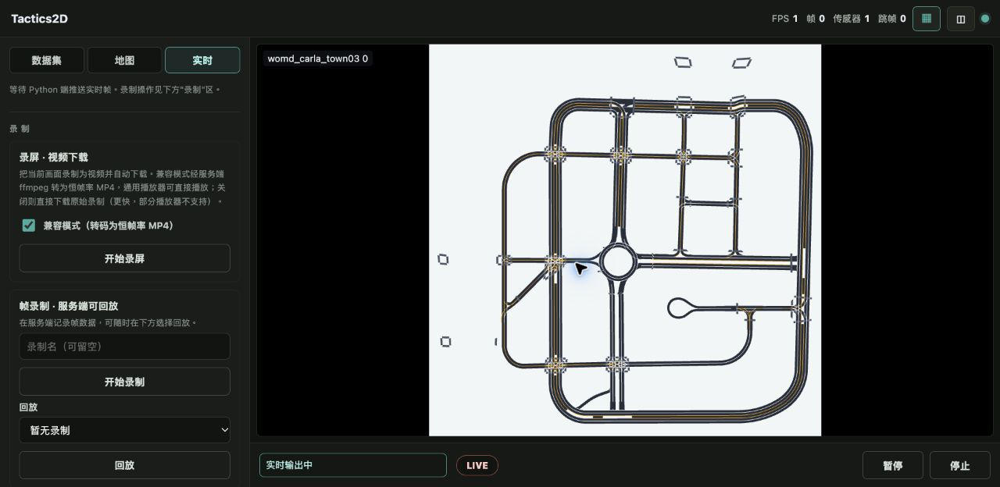

## Foreword

When it comes to maps for autonomous driving, you may have heard of OpenDRIVE, Lanelet2, or Apollo's HD Map. All of these formats can record roads and lanes, but if you open the files and take a look, you will find that the data inside looks quite different. Some describe roads with mathematical functions, some split a lane into a left and a right boundary, and others directly list the centerline together with the IDs of all adjacent lanes.

So why do we need so many formats? A simulator has to generate roads, the planning system on the vehicle has to decide where the vehicle can go, and a behavior prediction model needs to know the road layout as well as how traffic participants such as vehicles and pedestrians move, so the information each of them needs is different. This article uses CARLA's Town03 map to introduce OpenDRIVE, Lanelet2 as used by Autoware, Apollo HD Map, and the map structure of the Waymo Open Motion Dataset, and then compares the problems that arise when converting between them.

## What an Autonomous Driving Map Contains

When we use navigation in daily life, we mostly only need to know which roads to take from A to B. Autonomous driving, however, also needs to know which lane the vehicle is in, how wide the lane is, which lane it connects to ahead, whether it can change lanes to the left or right, which lanes a traffic light controls, and so on, so the information a map has to record is much more detailed.

This information can be roughly divided into geometry, topology, and semantics. Geometry is basically the shape and position of the road, such as planar coordinates and height; topology is how lanes are connected to each other, such as predecessor/successor connections and left/right adjacency; semantics represents lane types, lane markings, speed limits, and traffic rules. For example, two lanes lying side by side describes their positional relationship in terms of geometry; whether a lane change is allowed between them additionally depends on whether the marking in between is a broken line or a solid line, as well as on the relevant traffic rules.

In addition, autonomous driving also uses point cloud maps for localization, and simulators may separately have buildings, trees, and road surface materials. This article mainly introduces the data formats for roads and lanes; these files do not contain the models and assets required for the entire simulation scene.

### CARLA Town03

To compare the differences between formats, we use the same Town03 here and convert the original OpenDRIVE into the other three formats. The source is the CARLA `Town03.xodr` included in the Scenic project, which was generated by RoadRunner and is in OpenDRIVE version 1.4. Town03 has a roundabout, multi-lane intersections, and roads with elevation changes, which makes it suitable for comparing how each format describes roads.


(Figure 1: esmini odrviewer reading the Town03 OpenDRIVE directly)

In Figure 1 you can see the elevation changes of the roads as well as the roundabout in the center. Only the road map is loaded here, without CARLA's complete city model, and some objects are displayed only as simplified shapes because their external models are missing.

This data has 417 `driving` lane segments with a total length of about 13.718 km, plus 12 `bidirectional` lane segments, 35 junctions, 38 traffic light objects, and 73 pedestrian crossings. The traffic lights control 112 lane segments in total, and the sampled height ranges from about −0.87 to 8.51 m. What is counted here is the lanes as recorded segment by segment in the file; the same lane may be cut into several segments, so we cannot say that the whole city has 417 lanes.

The main differences among the four formats are as follows:

| Format | Main purpose | Geometry representation | Lane connectivity | File form |
| --- | --- | --- | --- | --- |
| OpenDRIVE | Data exchange between road design and simulators | Reference line plus width and elevation functions | Links of road, lane, and junction | XML, `.xodr` |
| Lanelet2 | Route planning and traffic rule evaluation | Left and right boundary polylines, optionally with a centerline | Routing graph built from shared boundaries, endpoints, and rules | OSM XML, `.osm` |
| Apollo HD Map | Apollo's routing, motion planning, and behavior prediction | Lane reference trajectory and left/right boundaries | Predecessor/successor and left/right neighbor lanes listed explicitly | Protobuf, `base_map.bin` |
| Waymo Open Motion | Behavior prediction and scenario research | Point sequences of centerlines, road lines, and road edges | Lane IDs and point-sequence index ranges | Scenario Protobuf, usually wrapped in TFRecord |

## OpenDRIVE

[OpenDRIVE](https://www.asam.net/fileadmin/Standards/OpenDRIVE/ASAM_OpenDRIVE_BS_V1-7-0.html) is a road data standard defined by ASAM, and simulation tools such as CARLA and esmini can all use it. Its most fundamental concept is the road reference line: each road first defines a reference line, and then the positions of each lane and road object are recorded relative to that line.

We can think of the reference line as the baseline of the road. The distance traveled along the line is called `s`, and the lateral offset to the left or right is called `t`, so `(s, t)` can represent a position on the road. The reference line is not necessarily the centerline of some lane, but we can take it as the baseline and use a single coordinate system to describe the shape and position of the whole road. For the detailed definition, see [ASAM's explanation of the reference line coordinate system](https://publications.pages.asam.net/standards/ASAM_OpenDRIVE/ASAM_OpenDRIVE_Specification/v1.8.1/specification/08_coordinate_systems/08_03_reference_line_coordinate_system.html).

The planar shape of the reference line is placed in `planView`, where lines, arcs, spirals (transition curves), and so on can be joined together to form one reference line. Lanes are placed in `laneSection` and described with width functions. A reader computes coordinates along the reference line and then adds the lane widths to the left and right to obtain the lane boundaries. Therefore, OpenDRIVE does not need to store every coordinate point of every lane.

Let us use Road 8 of Town03, its first lane section, and *lane -1* as an example. This is a straight lane about 18.13 m long and 3.5 m wide. Its width and outer road mark settings are as follows, with other attributes and child elements omitted for now:

```xml
<lane id="-1" type="driving" level="false">
  <width sOffset="0" a="3.5" b="0" c="0" d="0" />
  <roadMark sOffset="0" type="broken" color="white"
            width="0.125" laneChange="both" />
</lane>
```

The four coefficients of `width` correspond to the cubic polynomial `w(ds) = a + b·ds + c·ds² + d·ds³`, where `ds` is the distance measured from the start of this width entry. In this example only `a` is 3.5 and the others are all 0, so the width of the whole lane is fixed at 3.5 m. If the road gradually widens, the other coefficients can be set to describe the change. OpenDRIVE also has a way of describing boundaries using `border`; Town03 uses `width` here.

`roadMark` represents the outer marking of this right-side lane; `broken` and `white` mean a white broken line, and the line width is 0.125 m. The inner side of this lane is next to the center of the road, and for the corresponding marking we have to look at the settings of the center lane.

OpenDRIVE lane IDs start from 0 at the center; the left side of the reference line is +1, +2, and the right side is −1, −2. Taking lane ID −1 as an example, different roads or different lane sections may each have a −1, so knowing only the lane ID is not enough to determine which lane it is; we also need to know which road and which section it belongs to. The sign indicates the left/right position, while the driving direction additionally has to be determined together with settings such as right-hand or left-hand traffic and bidirectional lanes.

To know where a lane connects to ahead and behind, we need to read the road link, the lane link, and the connection and laneLink inside the junction. For example, after a road enters an intersection it may go straight or turn right; the junction records the corresponding connecting roads and lanes, and the reading program then organizes this information into a drivable road network.

OpenDRIVE can also describe elevation and superelevation (also called bank angle). Elevation records the height along the road, so it can represent uphill and downhill sections; superelevation is the lateral tilt of the road, such as the height difference between the inner and outer sides of a curve. The elevation of Town03 varies, but the superelevation coefficients in the source file are all 0.

## Lanelet2

[Lanelet2](https://github.com/fzi-forschungszentrum-informatik/Lanelet2/blob/master/lanelet2_core/doc/LaneletPrimitives.md) is a map format commonly used by Autoware. Its basic unit is the lanelet, which can be thought of as a drivable section enclosed by a left and a right polyline (linestring). Within a single lanelet, the traffic rules and the conditions for whether lane changes are allowed must all be the same. If the rules or conditions change at some position, the lanelet has to be cut there into another lanelet.

Lanelet2 can be stored as OSM XML, in which a `node` is a coordinate point, a `way` is a polyline made up of a sequence of nodes, and a `relation` is used to combine left and right boundaries and rules. Note that this merely reuses the file structure of OpenStreetMap; the data content is still our own lane map.

For the same *lane −1* of Road 8 from earlier, converting to Lanelet2 gives the following relation:

```xml
<relation id="47981" visible="true" version="1">
  <member type="way" ref="5356" role="left" />
  <member type="way" ref="5377" role="right" />
  <tag k="type" v="lanelet" />
  <tag k="subtype" v="road" />
  <tag k="one_way" v="yes" />
  <tag k="participant:vehicle" v="yes" />
  <tag k="speed_limit" v="80" />
</relation>
```

We can see that relation 47981 references way 5356 on the left and way 5377 on the right, and only by going further into the ways to look up the nodes do we get the actual coordinates. The nodes in this output have `lat` and `lon`, and come with the tags `ele`, `local_x`, and `local_y`; `ele` records the height, while `local_x` and `local_y` record local coordinates. When loading, a matching projection setting must be used, and we also need to confirm whether the reading tool actually adopts these local coordinates.

There is one thing here that is very easy to overlook during conversion: adjacent lanes should share the same boundary object. If there is one and the same white broken line between two lanes, the two lanelets should reference the same way. Suppose we instead generate one way for each with exactly the same coordinates; the rendered result will look no different, but Lanelet2 may fail to determine that they are adjacent. Lanelets that follow one another also need to share their endpoints correctly.

However, sharing a boundary does not mean a lane change is possible; it also depends on the marking type and the traffic rules. For example, even though two lanes are adjacent, if they are separated by a solid line, a vehicle cannot simply cross the solid line to change lanes. Lanelet2's [routing graph](https://docs.ros.org/en/humble/p/lanelet2_routing/) distinguishes which adjacent lanes can be switched to and which cannot. We can also build separate routing graphs according to the traffic rules for cars, bicycles, and pedestrians.

Traffic lights, stop lines, and right of way are described through regulatory elements (traffic rule objects). For instance, if one traffic light controls three lanes, we can create a relation that references the light and the stop line, and then have all three lanelets reference this rule. This way the rule can be shared, and it is also easier to extend.


(Figure 2: Town03 in JOSM with the Lanelet2 mapcss style applied)

Figure 2 is the result drawn with JOSM, in which the left and right boundaries, the intersections, and the roundabout are all visible. JOSM can be used to inspect and edit the objects in the OSM file; as for whether a route can be planned from one lane to another, that needs to be tested separately with Lanelet2's routing graph or with the target system.

## Apollo HD Map

Apollo HD Map stores maps using Protocol Buffers (Protobuf). You will generally see the binary file `base_map.bin`, and a text version `base_map.txt` can also be exported for easier inspection. It puts the geometry and connectivity information of a lane in the [Lane message](https://github.com/ApolloAuto/apollo/blob/master/modules/common_msgs/map_msgs/map_lane.proto), including `central_curve`, the left and right boundaries, the length, the speed limit, as well as the predecessor and successor lanes and the left and right neighbor lanes. According to the definition of the data structure (schema), `central_curve` is a reference trajectory and is not necessarily located exactly at the geometric center of the lane.

Our lane from earlier is called `lane_8_0_-1` in this output. With the coordinate points omitted, we can see the following relationships:

```protobuf
id { id: "lane_8_0_-1" }
speed_limit: 22.352
predecessor_id { id: "lane_482_0_-1" }
successor_id { id: "lane_1197_0_-3" }
right_neighbor_forward_lane_id { id: "lane_8_0_-2" }
left_neighbor_reverse_lane_id { id: "lane_8_0_1" }
type: CITY_DRIVING
turn: NO_TURN
direction: FORWARD
```

`predecessor_id` and `successor_id` record the IDs of the preceding and following lanes respectively; the neighbor on the right is the same-direction lane `lane_8_0_-2`, while the neighbor on the left is the opposite-direction lane `lane_8_0_1`. Notice that the IDs of the predecessor/successor lanes and of the left/right neighbor lanes are all already listed, so to find where this lane connects to, we can simply look it up by ID without having to infer the relationships between lanes from their boundaries. However, when generating the map we must ensure that the connectivity recorded by the IDs matches the actual positions of the lanes, and they must also be updated together whenever a road is modified.

Apollo additionally uses [overlap](https://github.com/ApolloAuto/apollo/blob/master/modules/common_msgs/map_msgs/map_overlap.proto) to record the relationships between lanes and other objects, for example the association of a lane with a traffic light, a pedestrian crossing, or a junction. An overlap records the object IDs as well as the `s` range on the corresponding lane, so the planning system can know which part of the lane is affected by the object.


(Figure 3: Town03 output of Apollo's official mapshow.py)

In Figure 3 you can see the lanes, signals, and pedestrian crossings. This conversion preserves the road, section, and junction structure, and outputs a total of 1,400 Lanes and 1,210 overlaps. Lanes include types such as driving, sidewalk, shoulder, and parking, so their number is larger than the 417 driving lane segments mentioned earlier.

When using an Apollo map, you need to pay attention to the version of the Protobuf schema and to the coordinate settings. The header of this output uses a `tmerc` projection string and the coordinate unit is meters; when using it together with other maps, you still have to confirm that the origin and the projection are the same.

## Waymo Open Motion

What is introduced here is the map data of the Waymo Open Motion Dataset (WOMD), which is used for behavior prediction and scenario research. It uses a [Scenario](https://github.com/waymo-research/waymo-open-dataset/blob/master/src/waymo_open_dataset/protos/scenario.proto) to record the map, the trajectories of traffic participants, and the signal states at different points in time. This article converts only the road data and does not generate vehicle trajectories, so the output Scenario contains only map data, and the signal states are all set to unknown.

Waymo's map is placed in `map_features`, in which every feature has its own ID; things like the lane centerline `LaneCenter`, the road marking `RoadLine`, the road edge `RoadEdge`, and the pedestrian crossing `Crosswalk` are each independent objects. We can see the complete definitions in [map.proto](https://github.com/waymo-research/waymo-open-dataset/blob/master/src/waymo_open_dataset/protos/map.proto). It does not have the road and lane section hierarchy that OpenDRIVE has, and lanes are mainly described by point sequences of centerlines.

The left and right boundaries of a lane are recorded by `BoundarySegment`, which references a feature representing a road line or a road edge. Lane −1 of Road 8 from earlier corresponds to feature 103 in this output, and the data for its left boundary is as follows:

```protobuf
left_boundaries {
  lane_start_index: 0
  lane_end_index: 19
  boundary_feature_id: 100051
  boundary_type: TYPE_SOLID_SINGLE_YELLOW
}
```

What this means is that for points 0 through 19 of the lane centerline, the left boundary corresponds to feature 100051. To get the boundary coordinates, we go and read the point sequence of that feature. When describing the relationship with left and right neighbor lanes, the point-sequence index ranges of this lane and of the neighbor lane are also recorded separately, so even when two lanes are adjacent only along part of their length, this can be described segment by segment.

This conversion samples roughly once every 1 m along the road, and the actual spacing in the example is about 0.954 m. Generally speaking, the denser the sampling, the more detail of the road shape can be preserved, but the number of points to store also increases, and the file naturally becomes larger.


(Figure 4: Tactics2D reading the Town03 Scenario TFRecord)

Figure 4 shows only roads and no vehicles, because this Scenario has no trajectory data. This output contains a total of 429 lane centerlines, 665 road lines, 32 road edge segments, and 73 pedestrian crossings; the 429 centerlines come from the 417 driving lane segments and the 12 bidirectional lane segments respectively. Tactics2D draws the XY plane; if you want to observe height, you can look at the Plotly figure generated by the official `plot_maps`.

Waymo does record how lanes connect ahead and behind, as well as same-direction neighbor lanes, but the road hierarchy and traffic rules are not as complete as in the previous formats, and some lanes have no left or right boundaries. If you want to use it to generate a complete road model, this information has to be filled in. What is discussed here is the structure of the publicly released WOMD data, and it does not represent the complete map used on Waymo's vehicles.

## How Traffic Lights Are Represented

Besides lanes, traffic lights are also important information that an autonomous driving map needs to record. OpenDRIVE records the position of a signal on the road, and then uses signalReference and validity to specify which lanes are controlled by the signal; Lanelet2 has lanelets reference the regulatory element of the traffic light; Apollo records the correspondence between signals and lanes through Signal and overlap.

Waymo is rather special: it records the signal state corresponding to each lane at every point in time. The `dynamic_map_states` of a Scenario contains `TrafficSignalLaneState`, which records the lane ID controlled by the signal, the signal state, and the stop point `stop_point`. In other words, what is recorded here is the signal state of a certain lane at a certain point in time, whereas the position and shape of the light itself are not stored separately.

| Format | Signal data | How it maps to the lanes controlled by the signal |
| --- | --- | --- |
| OpenDRIVE | Position and attributes of the signal | signalReference, validity |
| Lanelet2 | Regulatory element of the light and the stop line | Lanelets reference the rule relation |
| Apollo | The light, its subsignals, and the stop line of a Signal | Overlap between Signal and Lane |
| Waymo Scenario | Signal state and stop point at each point in time | Lane ID of TrafficSignalLaneState |

The OpenDRIVE of Town03 does not record data on how the red, yellow, and green lights switch over time, so this Waymo output records the signal-controlled lanes and stop points only at time 0, and all signal states are `LANE_STATE_UNKNOWN`. If we later want to simulate a vehicle stopping at a red light, signal phases or other control data will additionally have to be provided.

## Map Format Conversion

Having looked at these data structures, we can see that quite a lot of information needs to be reorganized when converting between formats. OpenDRIVE's width functions cannot be put directly into a Lanelet2 way; the boundary coordinates must be computed first. Apollo requires explicit predecessor and successor lane IDs, so the road and junction connections of OpenDRIVE have to be sorted out. Waymo's boundaries are referenced through feature IDs, and the corresponding centerline index ranges also have to be computed.

All three formats converted this time use the same OpenDRIVE parsing result. We first sample along the reference line, then apply the lane offset, width, elevation, and superelevation to obtain the centerlines and the left and right boundaries. Next we organize the lane connections, signal control, and pedestrian crossings, and then write them out in each of the three formats.

### Units and Lane Markings

Let us first look at the speed limit. The speed limit recorded for Road 8 in the original file is 50 mph, and the three outputs are respectively:

| Format | Output speed limit | Unit |
| --- | --- | --- |
| Lanelet2 | `speed_limit="80"` | km/h; this output keeps only the integer |
| Apollo | `speed_limit: 22.352` | m/s |
| Waymo | `speed_limit_mph: 50.0` | mph; the field type is double |

The same speed limit may use different units in different formats, so the number cannot simply be copied over during conversion. Dropping the decimals also introduces some error: 50 mph is about 80.4672 km/h, and this Lanelet2 output did not keep the fractional part.

Lane markings have a similar problem. The center marking of Road 8 in OpenDRIVE is a `solid solid` yellow line, but after the example is converted, Lanelet2 keeps only the solid tag, Apollo has `SOLID_YELLOW`, and Waymo has `TYPE_SOLID_SINGLE_YELLOW`. In other words, this boundary was originally a double yellow line, but this piece of information is lost after conversion. Apollo and Waymo actually both have a double yellow line type, so for this problem we need to go back and check which boundary was taken during conversion, as well as how the markings are mapped.

### Data Volume After Conversion

The lane types preserved by each format this time also differ. Lanelet2 output driving, sidewalk, and pedestrian crossings, without parking or shoulder; Apollo preserved more types; and for Waymo, lane centerlines were output only for driving and bidirectional lanes. These differences depend on which data this particular conversion program preserved. For example, Lanelet2 also has Area and can be extended with rules, so it could record even more content.

The sizes of the files are as follows, calculated here with 1 MB = 1,000,000 bytes:

| File | Size | Content |
| --- | --- | --- |
| OpenDRIVE XML | 4.59 MB | Original road parameters and objects |
| Lanelet2 OSM XML | 10.80 MB | 46,765 nodes, 1,564 ways, 848 relations |
| Apollo binary | 11.27 MB | 1,400 Lanes, 1,210 overlaps |
| Apollo text version | 43.31 MB | The same Apollo map stored in text format |
| Waymo TFRecord | 1.27 MB | 1,199 map features, without trajectories |

We can see that the Lanelet2 and Apollo files are both larger than the original OpenDRIVE; the main reason is that after converting the road shape into a sequence of coordinate points, there are more coordinates to store. Also, for the very same Apollo map, the text version is much larger than the binary version. The Waymo file is the smallest, but it also lacks the road hierarchy and some lane types, so this table can only compare the sizes of this particular output, and we cannot yet judge from it which format has the best storage efficiency.

### Reverse Conversion

So can the converted map be converted back to OpenDRIVE? A new file can be generated, but restoring the original road parameters is very difficult. Take an arc as an example: after sampling, all we have left is a sequence of coordinate points, and fitting them again will not necessarily yield the original arc parameters; in addition, how roads and lane sections are split may also have to be decided anew.

Lanelet2 and Apollo both have boundary polylines, so the geometry is comparatively easy to map, but their respective structures still have to be handled. When converting Apollo to Lanelet2, the boundaries stored redundantly by adjacent lanes have to be merged into the same way; when converting Lanelet2 to Apollo, roads, sections, and overlaps have to be created. As for restrictions on which participants may pass, custom traffic rules, and objects specific to each format, there may also be no field they can be mapped to directly.

Converting from Waymo back to other formats is even more troublesome, because some lanes have no boundaries, and there is no road hierarchy or light position either. If boundaries are generated on both sides from the centerline and the lane width is set to a fixed value, that width is an extra assumption, and the generated road is not necessarily the same as the original. When this kind of handling is needed, it is best to mark the synthesized data so that it is easier to check later.

Therefore, in practice it is best to keep the original map and convert to other formats based on it. If the source is OpenDRIVE, keep the functions that describe the roads; if the source is Lanelet2, keep the shared objects and rules. When the map needs to be changed later, make the changes in the original data too, rather than in a converted copy, to avoid a situation where a lot of information can no longer be recovered after converting back and forth a few times.

## Map Viewing and Validation

After converting a map, you can first take a look at the result with a viewer. Here I summarize the viewing records from the original website dated 2026-10-10. The desktop and lightweight viewing tools were mainly run on macOS arm64, while Apollo 8 Dreamview ran on a Linux backend and was accessed from a browser on the Mac:

| Format | Tool | Result for Town03 |
| --- | --- | --- |
| OpenDRIVE | esmini odrviewer | Displays 3D roads |
| Lanelet2 | JOSM + Lanelet2 style, Tactics2D | Roads displayed successfully |
| Apollo | mapshow.py, Apollo 8 Dreamview | Displays lanes, signals, and pedestrian crossings |
| Waymo | Official plot_maps, Tactics2D | Map displayed successfully; Tactics2D shows only XY |

The files themselves were also checked: for Lanelet2, the XML objects and their reference relationships were checked; for Apollo, whether the binary file can be parsed, and whether the data stays consistent after converting it to text and back; for Waymo, the TFRecord CRC, deserialization, and index ranges. This can catch problems such as duplicate IDs, references to nonexistent objects, or out-of-range indices, but if the markings are mapped incorrectly, or a place where lane changes are not allowed is treated as one where they are, separate tests are still needed to discover it.

If the map is to be handed to a planning system, we also have to test whether the specified vehicle type can travel along the planned route, whether vehicles are wrongly allowed to cross a solid line to change lanes, and whether the traffic lights are mapped to the correct lanes. Elevated roads in particular may cross each other on a planar map, so elevation and projection must be checked together; otherwise the picture may look perfectly normal while the planned route is wrongly connected to a road at a different height.

## Conclusion

This article used the same Town03 to introduce four autonomous driving map formats. OpenDRIVE mainly describes roads with reference lines and functions, Lanelet2 composes lanelets from left and right boundaries combined with traffic rules, Apollo explicitly stores lane geometry and connectivity, and Waymo Open Motion describes scenes with map features and time series.

If you want to become more familiar with these formats, you can start from the Road 8 example in this article and compare its boundaries, speed limit, and neighbor lanes across the four kinds of files. When you actually do format conversion, pay attention to units, shared objects, and information missing from the source, and after converting, remember to check the road shapes and the route planning results with the system that will actually use the map.
