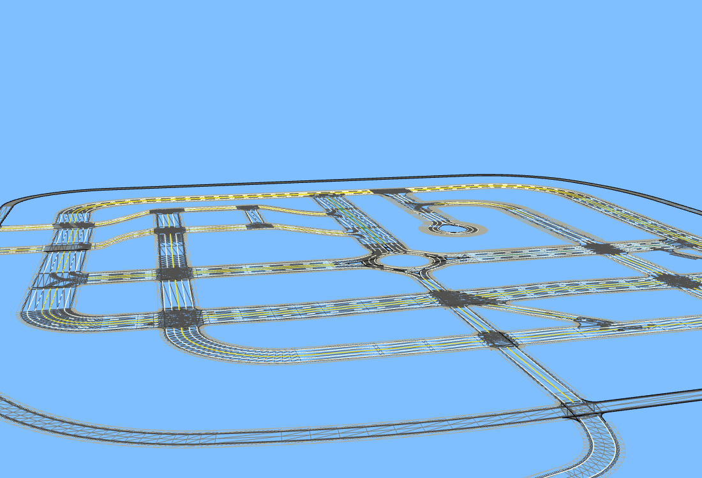
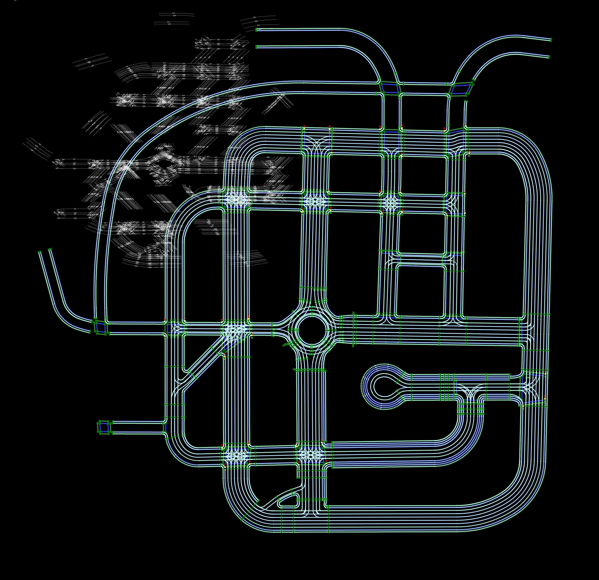
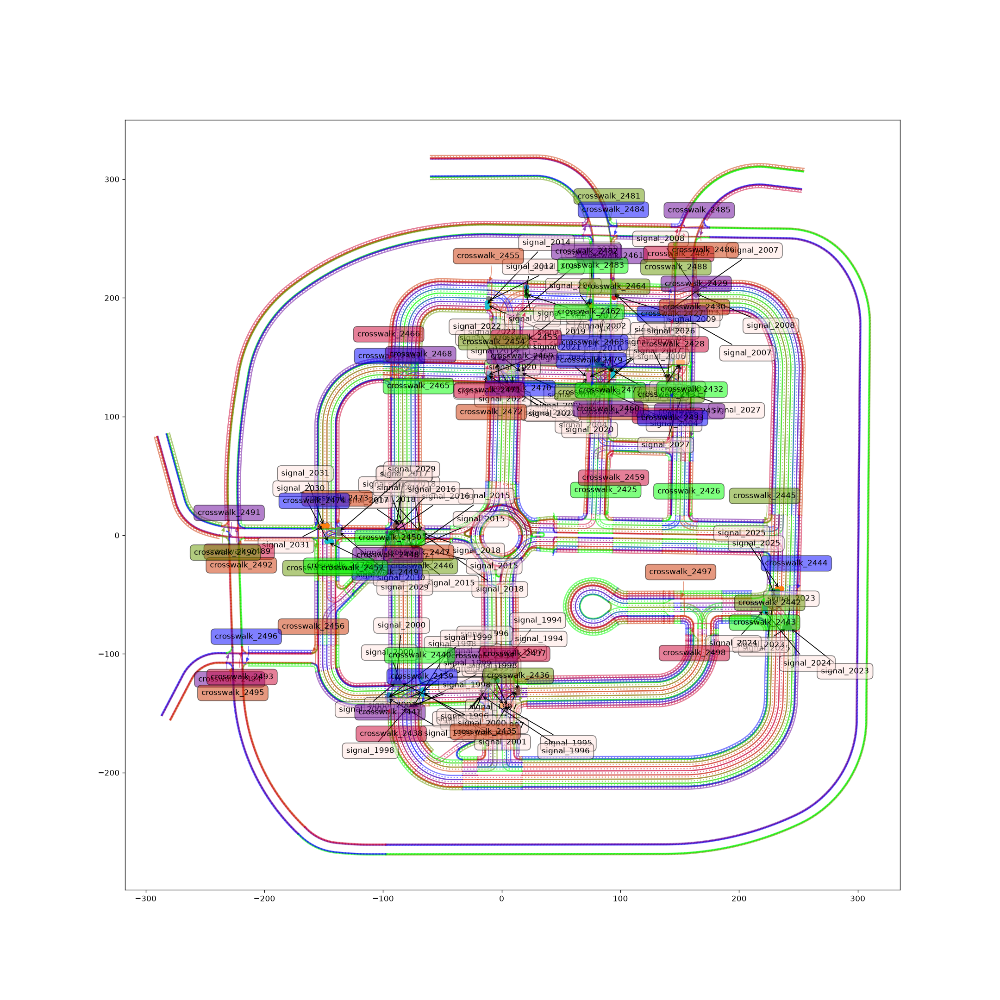
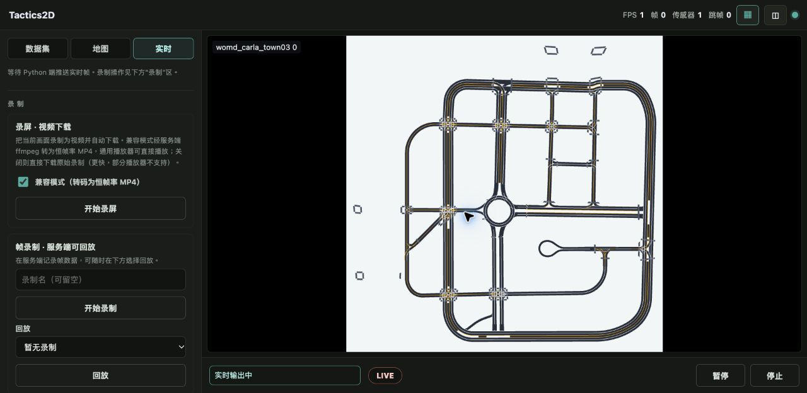

## はじめに

自動運転の地図といえば、OpenDRIVE、Lanelet2、あるいは Apollo の HD Map を聞いたことがあるかもしれません。これらのフォーマットはいずれも道路と車線を記録できますが、ファイルを開いて見てみると、中のデータの姿はかなり違っていることが分かります。数学関数で道路を記述するものもあれば、車線を左右 2 本の境界に分けるものもあり、中心線と隣接車線の ID をすべてそのまま列挙するものもあります。

では、なぜこれほど多くのフォーマットが必要なのでしょうか。シミュレータは道路を生成しなければならず、車両上のプランニングシステムは車がどこへ進めるのかを判断しなければならず、行動予測モデルは道路の構成と、車両や歩行者などの交通参加者がどのように動くのかを知る必要があります。そのため、それぞれが必要とする情報も異なります。本記事では CARLA の Town03 マップを使って、OpenDRIVE、Autoware が使用する Lanelet2、Apollo HD Map、そして Waymo Open Motion Dataset の地図構造を紹介し、続いてそれらを相互に変換するときにどのような問題に直面するのかを比較します。

## 自動運転地図の内容

普段ナビを使うとき、私たちはたいてい A から B までどの道を通ればよいかが分かれば十分です。しかし自動運転では、自分がどの車線にいるのか、車線の幅はどれくらいか、前方でどの車線につながるのか、左右に車線変更できるのか、信号機がどの車線を制御しているのか、といったことまで知る必要があります。そのため、地図が記録すべき情報はずっと細かくなります。

これらの情報は、おおまかに幾何（geometry）、トポロジー（topology）、セマンティクス（semantics）に分けられます。幾何は基本的に道路の形状と位置のことで、平面座標や高さなどがこれにあたります。トポロジーは車線同士がどのようにつながっているかで、例えば前後の接続や左右の隣接です。セマンティクスは車線の種類、区画線、制限速度、交通ルールを表します。例えば、2 本の車線が並んで隣接しているというのは、幾何上の位置関係を述べているにすぎません。車線変更ができるかどうかは、さらにその間の区画線が破線なのか実線なのか、そして関連する交通ルールを見なければなりません。

また、自動運転では自己位置推定のために点群地図も使いますし、シミュレータには建物、樹木、路面のマテリアルが別途ある場合もあります。本記事では主に道路と車線のデータフォーマットを紹介します。これらのファイルには、シミュレーションシーン全体に必要なモデルやアセットは含まれていません。

### CARLA Town03

フォーマットの違いを比較するため、ここでは同じ Town03 を使い、元の OpenDRIVE を他の 3 種類のフォーマットに変換します。ソースは Scenic プロジェクトに収録されている CARLA の `Town03.xodr` で、RoadRunner によって生成されたもので、バージョンは OpenDRIVE 1.4 です。Town03 にはラウンドアバウトや多車線の交差点があり、起伏のある道路もあるので、各フォーマットが道路をどのように記述するかを比較するのに適しています。


（図1：esmini odrviewer で Town03 の OpenDRIVE を直接読み込んだ画面）

図1 では、道路の高低の変化と、中央のラウンドアバウトが確認できます。ここでは道路地図だけを読み込んでおり、CARLA の完全な都市モデルはありません。一部のオブジェクトは外部モデルがないため、簡略化された形状でしか表示されません。

このデータには 417 区間の `driving` 車線があり、総延長は約 13.718 km です。そのほかに 12 区間の `bidirectional` 車線、35 個の交差点、38 個の信号機オブジェクト、73 か所の横断歩道があります。信号機は合計 112 区間の車線を制御しており、サンプリング後の高さの範囲はおよそ −0.87 から 8.51 m です。ここで集計しているのは、ファイル中で区間ごとに記録されている車線です。同じ 1 本の車線がいくつもの区間に分割されていることがあるため、街全体に 417 本の車線があるとは言えません。

4 種類のフォーマットの主な違いは次のとおりです。

| フォーマット | 主な用途 | 幾何の表現 | 車線の接続関係 | ファイル形式 |
| --- | --- | --- | --- | --- |
| OpenDRIVE | 道路設計とシミュレータ間のデータ交換 | 参照線と、幅・標高の関数 | road、lane、junction の link | XML、`.xodr` |
| Lanelet2 | 経路計画と通行ルールの判定 | 左右境界のポリライン。中心線を持つことも可能 | 共有境界、端点、ルールからルーティンググラフを構築 | OSM XML、`.osm` |
| Apollo HD Map | Apollo の経路計画、走行計画、行動予測 | 車線の参照軌跡と左右境界 | 前後に接続する車線と左右の隣接車線を明示的に列挙 | Protobuf、`base_map.bin` |
| Waymo Open Motion | 行動予測とシナリオ研究 | 中心線、区画線、道路端の点列 | 車線 ID と点列のインデックス範囲 | Scenario Protobuf、通常は TFRecord に格納 |

## OpenDRIVE

[OpenDRIVE](https://www.asam.net/fileadmin/Standards/OpenDRIVE/ASAM_OpenDRIVE_BS_V1-7-0.html) は ASAM が策定した道路データの標準規格で、CARLA や esmini などのシミュレーションツールで使用できます。その最も基本的な概念は道路の参照線（reference line）です。各 road はまず 1 本の参照線を定義し、その線を基準として、各車線や道路オブジェクトの位置を記録します。

参照線は道路の基準だと考えることができます。線に沿って進んだ距離を `s`、左右へオフセットした距離を `t` と呼ぶので、`(s, t)` で道路上の位置を表すことができます。参照線は必ずしもどれかの車線の中心線であるとは限りませんが、これを基準にして、同じ一つの座標系で道路全体の形状と位置を記述することができます。詳しい定義は [ASAM の参照線座標系の説明](https://publications.pages.asam.net/standards/ASAM_OpenDRIVE/ASAM_OpenDRIVE_Specification/v1.8.1/specification/08_coordinate_systems/08_03_reference_line_coordinate_system.html)を参照してください。

参照線の平面形状は `planView` の中に置かれ、直線（line）、円弧（arc）、緩和曲線（spiral）などをつなぎ合わせて 1 本の参照線を構成できます。車線は `laneSection` の中に置かれ、幅の関数で記述されます。読み込みツールは参照線に沿って座標を計算し、そこから左右に車線幅を加えることで、車線の境界を得ることができます。そのため OpenDRIVE では、各車線のすべての座標点を保存しておく必要がありません。

Town03 の Road 8、最初の lane section、*lane -1* を例にします。これは長さ約 18.13 m、幅 3.5 m の直線車線で、その幅と外側の区画線の設定は次のとおりです。その他の属性と子要素はひとまず省略します。

```xml
<lane id="-1" type="driving" level="false">
  <width sOffset="0" a="3.5" b="0" c="0" d="0" />
  <roadMark sOffset="0" type="broken" color="white"
            width="0.125" laneChange="both" />
</lane>
```

`width` の 4 つの係数は 3 次多項式 `w(ds) = a + b·ds + c·ds² + d·ds³` に対応しており、`ds` はこの width 設定の始点から測った距離です。この例では `a` だけが 3.5 で、その他はすべて 0 なので、車線全体の幅は 3.5 m で一定です。道路が徐々に広がっていく場合は、他の係数を設定してその変化を記述できます。OpenDRIVE には `border` を使って境界を記述する方法もありますが、Town03 のここでは `width` が採用されています。

`roadMark` はこの右側車線の外側の区画線を表しており、`broken` と `white` はつまり白の破線で、線幅は 0.125 m です。この車線の内側は道路中央に近い側で、対応する区画線については中央車線の設定を見る必要があります。

OpenDRIVE の車線 ID は中央の 0 から始まり、参照線の左側が +1、+2、右側が −1、−2 となります。車線 ID −1 を例に取ると、異なる道路や異なる lane section の中にそれぞれ −1 が存在しうるので、lane ID が分かるだけではどの車線なのかを特定できず、それがどの road、どの section に属しているのかも知る必要があります。正負の符号は左右の位置を表しており、進行方向はさらに右側通行か左側通行か、双方向車線かといった設定と合わせて判断しなければなりません。

車線の前後がどこにつながっているかを知るには、road link、lane link、そして交差点 junction の中の connection と laneLink を読み取る必要があります。例えば、ある道路が交差点に入ったあと直進も右折もできる場合、junction が対応する接続道路と車線を記録しており、読み込みプログラムがそれらの情報を走行可能な道路ネットワークへと整理します。

OpenDRIVE は標高（elevation）と横断勾配（superelevation、bank angle とも呼ばれます）も記述できます。標高は道路に沿った高さを記録するので、上り坂や下り坂を表現できます。横断勾配は道路の横方向の傾きで、カーブの内側と外側の高低差などがこれにあたります。Town03 の標高には変化がありますが、ソースファイル中の superelevation の係数はすべて 0 です。

## Lanelet2

[Lanelet2](https://github.com/fzi-forschungszentrum-informatik/Lanelet2/blob/master/lanelet2_core/doc/LaneletPrimitives.md) は Autoware でよく使われる地図フォーマットで、その基本単位は lanelet です。これは左右 2 本のポリライン（linestring）で囲まれた、通行可能な一区間だと考えることができます。同じ 1 つの lanelet の中では、交通ルールも車線変更が可能かどうかの条件も同じでなければなりません。ある位置でルールや条件が変わる場合は、そこで切って別の lanelet にする必要があります。

Lanelet2 は OSM XML で保存できます。その中で `node` は座標点、`way` は一連の node からなるポリライン、`relation` は左右の境界やルールを組み合わせるために使われます。ここでは OpenStreetMap のファイル構造を流用しているだけで、データの内容はあくまで私たち自身の車線地図であることに注意してください。

先ほどと同じ Road 8 の *lane −1* を Lanelet2 に変換すると、次の relation が得られます。

```xml
<relation id="47981" visible="true" version="1">
  <member type="way" ref="5356" role="left" />
  <member type="way" ref="5377" role="right" />
  <tag k="type" v="lanelet" />
  <tag k="subtype" v="road" />
  <tag k="one_way" v="yes" />
  <tag k="participant:vehicle" v="yes" />
  <tag k="speed_limit" v="80" />
</relation>
```

relation 47981 が左側の way 5356 と右側の way 5377 を参照しており、さらに way の中の node をたどって初めて実際の座標が得られることが分かります。この出力の node には `lat`、`lon` があり、`ele`、`local_x`、`local_y` のタグが付いています。`ele` は高さを、`local_x` と `local_y` はローカル座標を記録しています。読み込む際には一致する投影設定を使う必要があり、読み込みツールがこれらのローカル座標を採用するかどうかも確認しなければなりません。

ここに、変換時にとても見落としやすい点が一つあります。それは、隣接する車線は同じ境界オブジェクトを共有すべきだということです。2 本の車線の間にあるのが同じ 1 本の白い破線であれば、2 つの lanelet は同じ way を参照すべきです。仮に座標がまったく同じ way をそれぞれ 1 本ずつ生成したとすると、描画結果に違いは出ませんが、Lanelet2 はそれらの隣接関係を判定できなくなる可能性があります。前後に連なる lanelet も、端点を正しく共有する必要があります。

ただし、境界を共有しているからといって車線変更ができるとは限らず、区画線の種類と交通ルールも見なければなりません。例えば 2 本の車線が隣接していても、その間が実線で隔てられていれば、実線をまたいでそのまま車線変更することはできません。Lanelet2 の [routing graph](https://docs.ros.org/en/humble/p/lanelet2_routing/) は、どの隣接車線へは移れて、どの隣接車線へは移れないのかを区別します。また、自動車、自転車、歩行者それぞれの通行ルールに応じて、ルーティンググラフを別々に構築することもできます。

信号機、停止線、優先権は regulatory element（交通ルールオブジェクト）を通じて記述します。例えば 1 基の信号機が 3 本の車線を制御している場合、灯器と停止線を参照する relation を 1 つ作成し、3 つの lanelet すべてにそのルールを参照させることができます。こうすればルールを共有でき、拡張もしやすくなります。


（図2：JOSM に Lanelet2 の mapcss スタイルを適用した Town03）

図2 は JOSM で描画した結果で、左右の境界、交差点、ラウンドアバウトがすべて確認できます。JOSM は OSM 内のオブジェクトの確認と編集に使えますが、ある車線から別の車線までの経路を計画できるかどうかについては、別途 Lanelet2 の routing graph や対象システムでテストする必要があります。

## Apollo HD Map

Apollo HD Map は Protocol Buffers（Protobuf）を使って地図を保存します。一般的には `base_map.bin` というバイナリファイルを目にしますが、確認しやすいようにテキスト版の `base_map.txt` を出力することもできます。車線の幾何と接続情報は [Lane message](https://github.com/ApolloAuto/apollo/blob/master/modules/common_msgs/map_msgs/map_lane.proto) の中に置かれており、`central_curve`、左右の境界、長さ、制限速度、そして前後に接続する車線と左右の隣接車線が含まれます。データ構造（schema）の定義によれば、`central_curve` は参照軌跡であり、必ずしも車線の幾何学的な中心にちょうど位置するとは限りません。

先ほどの車線は、この出力では `lane_8_0_-1` という名前になっています。座標点を省略すると、次のような関係が見えます。

```protobuf
id { id: "lane_8_0_-1" }
speed_limit: 22.352
predecessor_id { id: "lane_482_0_-1" }
successor_id { id: "lane_1197_0_-3" }
right_neighbor_forward_lane_id { id: "lane_8_0_-2" }
left_neighbor_reverse_lane_id { id: "lane_8_0_1" }
type: CITY_DRIVING
turn: NO_TURN
direction: FORWARD
```

`predecessor_id` と `successor_id` はそれぞれ前後に接続する車線の ID を記録しており、右側に隣接しているのは同方向の車線 `lane_8_0_-2`、左側に隣接しているのは対向車線 `lane_8_0_1` です。前後の車線と左右の隣接車線の ID がすでにすべて列挙されていることが分かります。そのため、この車線がどこにつながっているかを調べたいときは、ID をもとにそのまま検索すればよく、境界から車線同士の関係を改めて判定する必要はありません。ただし地図を生成する際には、ID で記録された接続関係が車線の実際の位置と一致していることを保証しなければならず、道路を修正するときにも合わせて更新する必要があります。

Apollo はこれとは別に [overlap](https://github.com/ApolloAuto/apollo/blob/master/modules/common_msgs/map_msgs/map_overlap.proto) を使って、車線と他のオブジェクトとの関係を記録します。例えば lane と信号機、横断歩道、junction との関連です。overlap はオブジェクトの ID と、対応する lane 上の `s` の範囲を記録するので、プランニングシステムはそのオブジェクトが車線のどの区間に影響するのかを知ることができます。


（図3：Apollo 公式 mapshow.py による Town03 の出力）

図3 では、車線、信号、横断歩道が確認できます。この変換では road、section、junction の構造を保持しており、合計で 1,400 個の Lane と 1,210 個の overlap を出力しています。Lane には driving、sidewalk、shoulder、parking などの種類が含まれるため、先ほどの 417 区間の driving 車線よりも数が多くなっています。

Apollo の地図を使う際は、Protobuf schema のバージョンと座標設定に注意が必要です。この出力の header は `tmerc` の投影文字列を使用しており、座標の単位はメートルです。他の地図と一緒に使う場合は、やはり原点と投影が同じかどうかを確認しなければなりません。

## Waymo Open Motion

ここで紹介するのは Waymo Open Motion Dataset（WOMD）の地図データで、行動予測とシナリオ研究に用いられます。これは [Scenario](https://github.com/waymo-research/waymo-open-dataset/blob/master/src/waymo_open_dataset/protos/scenario.proto) を使って、地図、交通参加者の軌跡、そして各時刻における信号の状態を記録します。本記事では道路データだけを変換し、車両の軌跡は生成していないため、出力される Scenario には地図データしかなく、信号の状態もすべて不明に設定しています。

Waymo の地図は `map_features` の中に置かれ、その中の各 feature はそれぞれ自分の ID を持っています。車線中心線の `LaneCenter`、区画線の `RoadLine`、道路端の `RoadEdge`、横断歩道の `Crosswalk` などは、いずれもそれぞれ独立したオブジェクトです。完全な定義は [map.proto](https://github.com/waymo-research/waymo-open-dataset/blob/master/src/waymo_open_dataset/protos/map.proto) で確認できます。OpenDRIVE のような road と lane section の階層はなく、車線は主に中心線の点列で記述されます。

車線の左右の境界は `BoundarySegment` によって記録され、区画線や道路端を表す feature を参照します。先ほどの Road 8 の lane −1 は、この出力では feature 103 に対応しており、左側境界のデータは次のとおりです。

```protobuf
left_boundaries {
  lane_start_index: 0
  lane_end_index: 19
  boundary_feature_id: 100051
  boundary_type: TYPE_SOLID_SINGLE_YELLOW
}
```

この部分の意味は、車線中心線の 0 番目から 19 番目までの点について、その左側の境界が feature 100051 に対応している、ということです。境界の座標を取得するには、その feature の点列を読みに行きます。左右の隣接車線との関係を記述するときにも、この車線と隣接車線それぞれの点列のインデックス範囲が記録されるので、2 本の車線が一部の区間でしか隣接していない場合でも、区間ごとに記述できます。

今回の変換では、道路に沿っておよそ 1 m ごとに 1 回サンプリングしており、例の中での実際の間隔は約 0.954 m です。一般的に言って、サンプリングが密であるほど道路形状の細部を多く残せますが、保存しなければならない点数も増え、ファイルも当然大きくなります。


（図4：Tactics2D で Town03 の Scenario TFRecord を読み込んだ画面）

図4 には道路だけが表示され、車両はありません。この Scenario には軌跡データがないからです。今回の出力には合計で 429 本の車線中心線、665 本の区画線、32 区間の道路端、73 か所の横断歩道が含まれており、この 429 本の中心線は、それぞれ 417 区間の driving 車線と 12 区間の bidirectional 車線に由来します。Tactics2D が描画するのは XY 平面なので、高さを観察したい場合は、公式の `plot_maps` が生成する Plotly の図を見るとよいでしょう。

Waymo は車線の前後がどのようにつながっているか、および同方向の隣接車線を記録していますが、道路の階層や交通ルールはここまでのフォーマットほど完全ではなく、しかも一部の車線には左右の境界がありません。これを使って完全な道路モデルを生成したい場合は、これらの情報を補う必要があります。ここで議論しているのは WOMD の公開データの構造であり、Waymo の車両上で使われている完全な地図を表しているわけではありません。

## 信号機の表現方法

車線のほかに、信号機も自動運転地図が記録すべき重要な情報です。OpenDRIVE は signal の道路上の位置を記録し、さらに signalReference と validity でどの車線が信号に制御されるかを指定します。Lanelet2 は lanelet に信号機の regulatory element を参照させます。Apollo は Signal と overlap を通じて、信号と車線の対応関係を記録します。

Waymo は少し特殊で、各時刻における、各車線に対応する灯火の状態を記録します。Scenario の `dynamic_map_states` の中には `TrafficSignalLaneState` があり、信号が制御する lane ID、灯火の状態、停止点 `stop_point` を記録します。つまり、ここで記録されているのは、ある時刻における、ある車線の灯火の状態であり、灯器の位置や形状については別途保存されていません。

| フォーマット | 信号データ | 信号に制御される車線への対応付け方 |
| --- | --- | --- |
| OpenDRIVE | signal の位置と属性 | signalReference、validity |
| Lanelet2 | 灯器と停止線の regulatory element | lanelet がルールの relation を参照 |
| Apollo | Signal の灯器、個々の信号灯（Subsignal）、停止線 | Signal と Lane の overlap |
| Waymo Scenario | 各時刻の灯火と停止点 | TrafficSignalLaneState の lane ID |

Town03 の OpenDRIVE は、赤・黄・青の灯火が時間とともに切り替わるデータを記録していないため、今回の Waymo 出力では時刻 0 にのみ、信号に制御される車線と停止点を記録しており、すべての灯火は `LANE_STATE_UNKNOWN` です。今後、車が赤信号で停止する様子をシミュレーションしたい場合は、さらに信号の現示やその他の制御データを与える必要があります。

## 地図フォーマットの変換

これらのデータ構造を見てくると、フォーマットを変換する際には、整理し直さなければならない情報が少なくないことが分かります。OpenDRIVE の幅の関数は Lanelet2 の way にそのまま入れることができず、先に境界の座標を計算しなければなりません。Apollo は前後の車線の ID を明示することを要求するので、OpenDRIVE の道路と交差点の接続をきちんと整理する必要があります。Waymo の境界は feature ID を通じて参照されるため、対応する中心線のインデックス範囲も計算しなければなりません。

今回変換した 3 種類のフォーマットは、すべて同じ OpenDRIVE の解析結果を使っています。まず参照線に沿ってサンプリングし、次に lane offset、幅、標高、横断勾配を適用して、中心線と左右の境界を取得します。続いて車線の接続、信号制御、横断歩道を整理し、それから 3 種類のフォーマットにそれぞれ書き出します。

### 単位と区画線

まず制限速度を見てみましょう。Road 8 が元のファイルで記録している制限速度は 50 mph で、3 種類の出力はそれぞれ次のとおりです。

| フォーマット | 出力された制限速度 | 単位 |
| --- | --- | --- |
| Lanelet2 | `speed_limit="80"` | km/h。今回の出力は整数のみを保持 |
| Apollo | `speed_limit: 22.352` | m/s |
| Waymo | `speed_limit_mph: 50.0` | mph。フィールドの型は double |

同じ制限速度でも、フォーマットによって使う単位が異なることがあるため、変換時に数字をそのまま書き写すことはできません。小数を保持しないことでも多少の誤差が生じます。例えば 50 mph は約 80.4672 km/h ですが、この Lanelet2 出力は小数部分を保持していません。

区画線にも似たような問題があります。Road 8 の OpenDRIVE の中央の区画線は `solid solid` の黄色線ですが、例を変換したあとでは、Lanelet2 には solid のタグだけが残り、Apollo は `SOLID_YELLOW`、Waymo は `TYPE_SOLID_SINGLE_YELLOW` になっています。つまり、この境界はもともと二重の黄色線だったのに、変換後にはその情報が欠けてしまっているのです。Apollo と Waymo には実際にはどちらにも二重黄色線の型があるので、この問題については、変換時にどの境界を取ってきたのか、そして区画線の対応付けの方法を、立ち戻って確認する必要があります。

### 変換後のデータ量

今回、各フォーマットが保持している車線の種類も異なります。Lanelet2 は driving、sidewalk、横断歩道を出力し、parking と shoulder は出力していません。Apollo は比較的多くの種類を保持しています。Waymo の車線中心線は driving と bidirectional の車線についてのみ出力しています。これらの違いは、今回の変換プログラムがどのデータを保持したかによって決まります。例えば Lanelet2 には Area もあり、ルールを拡張することもできるので、さらに多くの内容を記録することも可能です。

各ファイルのサイズは次のとおりです。ここでは 1 MB = 1,000,000 bytes として計算しています。

| ファイル | サイズ | 内容 |
| --- | --- | --- |
| OpenDRIVE XML | 4.59 MB | 元の道路パラメータとオブジェクト |
| Lanelet2 OSM XML | 10.80 MB | 46,765 個の node、1,564 個の way、848 個の relation |
| Apollo バイナリ | 11.27 MB | 1,400 個の Lane、1,210 個の overlap |
| Apollo テキスト版 | 43.31 MB | 同じ Apollo 地図をテキスト形式で保存したもの |
| Waymo TFRecord | 1.27 MB | 1,199 個の map feature、軌跡は含まない |

Lanelet2 と Apollo のファイルはどちらも元の OpenDRIVE より大きいことが分かります。その主な理由は、道路形状を一連の座標点に変換すると、保存すべき座標が増えるからです。また、同じ Apollo の地図でも、テキスト版はバイナリ版よりずっと大きくなっています。Waymo のファイルが最も小さいですが、道路の階層や一部の車線の種類が欠けてもいるので、この表で比較できるのは今回の出力のサイズだけであり、これをもとにどのフォーマットの保存効率が最も良いかを判断することはまだできません。

### 逆方向の変換

では、変換して出てきた地図を、もう一度 OpenDRIVE に戻すことはできるのでしょうか。新しく 1 つ生成し直すことはできますが、元の道路パラメータを復元するとなると、とても難しくなります。円弧を例に取ると、サンプリングしたあとには一連の座標点しか残っておらず、そこからフィッティングし直しても、元の円弧パラメータが得られるとは限りません。加えて、road と lane section の分割の仕方も、改めて決め直す必要が出てくるかもしれません。

Lanelet2 と Apollo にはどちらも境界のポリラインがあるので、幾何は比較的対応付けやすいのですが、それでもそれぞれの構造を処理しなければなりません。Apollo から Lanelet2 へ変換するときは、隣接車線が重複して保存している境界を、同じ 1 本の way に統合する必要があります。Lanelet2 から Apollo へ変換するときは、road、section、overlap を構築しなければなりません。さらに、通行対象の制限、独自の交通ルール、各フォーマット固有のオブジェクトについても、直接対応付けられるフィールドが見つからない可能性があります。

Waymo から他のフォーマットへ戻すのはさらに厄介です。一部の車線には境界がなく、道路の階層も灯器の位置もないからです。中心線から両側に境界を生成し、車線幅を固定値に設定した場合、その幅は追加で仮定したものであり、生成された道路が元と同じであるとは限りません。このような処理が必要なときは、合成したデータに印を付けておき、あとで確認しやすくしておくのがよいでしょう。

したがって実務上は、元の地図を保持しておき、その地図をもとに他のフォーマットへ変換するのが最善です。ソースが OpenDRIVE なら道路を記述する関数を残しておき、ソースが Lanelet2 なら共有オブジェクトとルールを残しておきます。あとで地図を変更するときにも元のデータから修正するようにして、何度か行ったり来たり変換しているうちに多くの情報が取り戻せなくなってしまう、という事態を避けます。

## 地図の表示と検証

地図を変換し終えたら、まずビューア（viewer）で結果を見てみるとよいでしょう。ここでは元サイトの 2026-10-10 の表示記録を整理します。デスクトップ版と軽量な表示ツールは主に macOS arm64 上で実行し、Apollo 8 Dreamview は Linux のバックエンドで動かして、Mac のブラウザから接続しました。

| フォーマット | ツール | Town03 の結果 |
| --- | --- | --- |
| OpenDRIVE | esmini odrviewer | 3D 道路を表示 |
| Lanelet2 | JOSM + Lanelet2 スタイル、Tactics2D | 道路の表示に成功 |
| Apollo | mapshow.py、Apollo 8 Dreamview | 車線、信号、横断歩道を表示 |
| Waymo | 公式 plot_maps、Tactics2D | 地図の表示に成功。Tactics2D は XY のみ表示 |

ファイルそのものについても検査を行いました。Lanelet2 は XML オブジェクトとその参照関係を検査し、Apollo はバイナリファイルを解析できるかどうか、およびテキストに変換してから再び戻したあとでデータが一致しているかどうかを検査し、Waymo は TFRecord の CRC、デシリアライズ、インデックス範囲を検査しました。これによって、ID の重複、参照先のオブジェクトが存在しない、インデックスが範囲外になっている、といった問題を検出できます。しかし、区画線の対応付けの誤りや、車線変更できない場所を車線変更できるものとして扱ってしまっているような場合は、さらに別のテストをしなければ発見できません。

地図をプランニングシステムに渡すのであれば、指定した車種が計画された経路に沿って通行できるかどうか、実線をまたいで車線変更することを誤って車両に許可していないかどうか、そして信号機が正しい車線に対応付けられているかどうかもテストしなければなりません。特に高架道路は平面図上で交差して見えることもあるので、標高と投影も合わせて検査する必要があります。そうしないと、画面上はごく正常に見えるのに、計画された経路が高さの異なる道路に誤ってつながってしまうおそれがあります。

## まとめ

本記事では、同じ Town03 を使って 4 種類の自動運転地図フォーマットを紹介しました。OpenDRIVE は主に参照線と関数で道路を記述し、Lanelet2 は左右の境界で lanelet を構成して交通ルールと組み合わせ、Apollo は車線の幾何と接続関係を明示的に保存し、Waymo Open Motion は map feature と時系列でシーンを記述します。

これらのフォーマットにもっと慣れたい場合は、本記事の Road 8 の例から始めて、4 種類のファイルの中での境界、制限速度、隣接車線を見比べてみるとよいでしょう。実際にフォーマット変換を行う際には、単位、共有オブジェクト、そしてソースに欠けている情報に注意し、変換し終えたら、実際にその地図を使うシステムで、道路の形状と経路計画の結果を確認することも忘れないでください。
